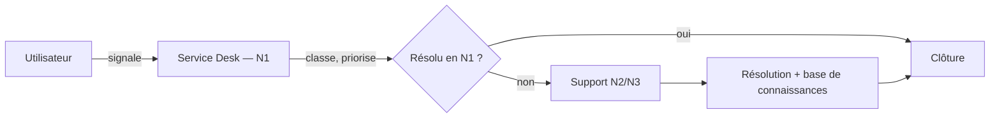

# GLPI — gestion des incidents (ITIL)

🇫🇷 [Français](#-français) · 🇬🇧 [English](#-english)

---

## 🇫🇷 Français

Travail réalisé à VILNIUS TECH (module *Gestion corporative de l’information et des technologies*, 2026) :
mise en place d’un **processus de gestion des incidents selon ITIL** pour un service de formation à
distance, puis test pratique dans l’outil **GLPI**.

> Scénario fictif (établissement de formation à distance). Aucune donnée réelle n’est utilisée.
> Le rapport d’origine contient des captures d’écran : il n’est pas publié ici.

### Processus (ITIL)

| Étape | Contenu |
|---|---|
| 1. Enregistrement | l’utilisateur signale l’incident via le portail Helpdesk |
| 2. Classification & priorité | catégorie, priorité = **urgence × impact** |
| 3. Corrélation | vérifier si un incident identique existe déjà |
| 4. Diagnostic | le N1 tente de résoudre ; sinon escalade |
| 5. Résolution | service rétabli, solution documentée |
| 6. Clôture | l’utilisateur confirme, le ticket est clôturé |

**Niveaux de support :** N1 Service Desk · N2 infrastructure · N3 spécialistes applicatifs · N4 fournisseurs.

### GLPI (Gestionnaire Libre de Parc Informatique)

Outil ITSM open source (éditeur Teclib’, France), compatible ITIL : gestion des tickets, des utilisateurs
et des profils, SLA, base de connaissances, inventaire du parc, notifications e-mail, interface multilingue.

### Ce que j’ai testé

- création d’utilisateurs et attribution de profils (Self-Service, Technician, Super-Admin) ;
- portail Helpdesk du point de vue d’un utilisateur final ;
- création de tickets d’incident avec calcul automatique de la priorité ;
- cycle de vie complet d’un incident, du signalement à la clôture ;
- tableau de bord : tickets par statut, incidents en retard, statistiques mensuelles.

Exemples de tickets testés : impossibilité de se connecter (priorité haute), vidéo de cours illisible,
mise à jour de sécurité non déployée, demande de création de compte.

### Ce que ça démontre

Connaissance du **processus ITIL de gestion des incidents**, du support à plusieurs niveaux et d’un outil
de ticketing réel — compétences directement utiles pour un poste de technicien support N1/N2.

---

## 🇬🇧 English

Work done at VILNIUS TECH (2026): designing an **ITIL incident-management process** for a distance-learning
service, then testing it hands-on in **GLPI**.

> Fictional scenario; no real data. The original report contains screenshots and is not published here.

### Process (ITIL)

Registration → classification & priority (**urgency × impact**) → correlation → diagnosis → resolution →
closure. Support tiers: N1 Service Desk, N2 infrastructure, N3 application specialists, N4 vendors.

### GLPI

Open-source ITSM tool (Teclib’, France), ITIL-compatible: ticketing, users and profiles, SLA, knowledge
base, asset inventory, e-mail notifications, multilingual UI.

### What I tested

User and profile creation (Self-Service, Technician, Super-Admin), the Helpdesk portal as an end user,
incident tickets with automatic priority, the full incident life cycle, and the admin dashboard
(tickets by status, overdue incidents, monthly statistics).

### What it shows

Knowledge of the ITIL incident-management process, multi-tier support and a real ticketing tool —
directly relevant to an L1/L2 IT support role.

---

Rédigé avec l’aide d’un assistant IA à partir de mon propre rapport. · Licence MIT
